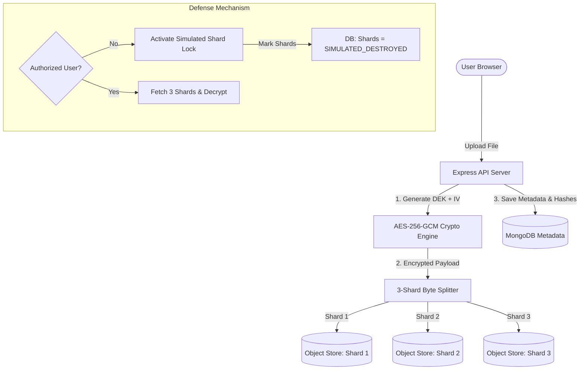
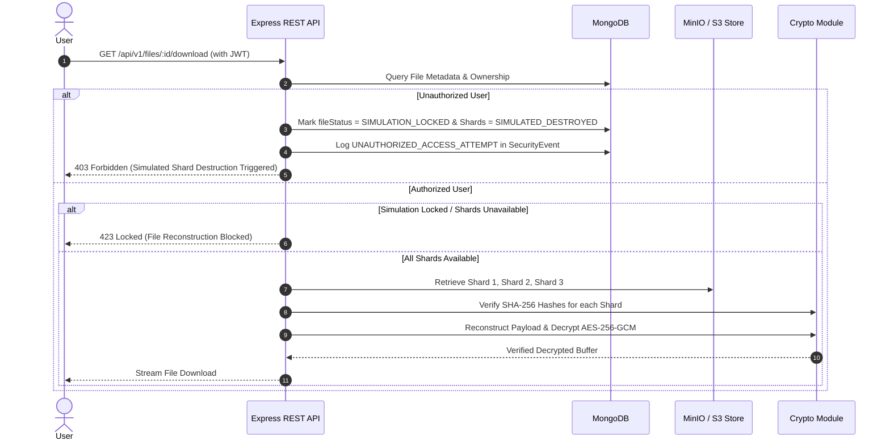

# TriVault — Secure Three-Shard Cloud Storage System

> **Tagline:** “Split into Three. Secured as One.”

TriVault is a cybersecurity-focused cloud storage system that encrypts uploaded files using **AES-256-GCM**, divides the encrypted payload into **exactly three logical shards** (Shard 1, Shard 2, Shard 3), stores those shards separately in object storage (MinIO / S3), and reconstructs the original file only when an authorized user requests it.

---

## 1. System Architecture



### Retrieval & Reconstruction Sequence Diagram



---

## 2. Key Technical Features

1. **AES-256-GCM Envelope Encryption**:
   - Each file gets a unique, cryptographically random 32-byte Data Encryption Key (DEK) and 12-byte (96-bit) IV nonce.
   - Plaintext DEK is encrypted with a Master Encryption Key (KEK) and stored securely in metadata.
   - GCM authentication tags are strictly verified prior to releasing decrypted data.

2. **Exact 3-Shard Byte Partitioning**:
   - The encrypted payload is split into exactly 3 logical byte partitions using deterministic math (`ceil(len/3)`, `ceil((len-size1)/2)`, `remaining`).
   - Every byte is preserved. No data is lost for text, image, PDF, or binary files.

3. **Dual Storage Adapter**:
   - Supports native MinIO S3 object storage with auto-bucket initialization.
   - Includes automatic local disk-storage fallback (`STORAGE_MODE=auto`) if MinIO is not running.

4. **Unauthorized Access Simulated Destruction Response**:
   - Attempting to download another user's file without authorization triggers a simulated security lockdown.
   - Shards are marked `SIMULATED_DESTROYED` in database state, locking reconstruction.
   - Physical objects in storage are preserved safely (Safety rule: real deletion disabled by default).
   - An administrator can reset the simulation via `POST /api/v1/admin/files/:id/reset-simulation`.

> [!WARNING]
> **Security Warning & DoS Risk**: The simulated shard-destruction feature is a prototype policy for field demonstration. In a production environment, triggering shard locks on unauthorized access can introduce a Denial-of-Service (DoS) vulnerability if an attacker deliberately attempts access to lock legitimate users' files.

---

## 3. Quick Start & Setup Instructions

### Prerequisites
- Node.js (v18+)
- Docker & Docker Compose (optional for MinIO + Mongo, or use local fallbacks)

### Step 1: Install Dependencies
```bash
# Install backend dependencies
cd backend
npm install

# Install frontend dependencies
cd ../frontend
npm install
```

### Step 2: Configure Environment Variables
Verify `backend/.env`:
```env
PORT=5000
MONGODB_URI=mongodb://127.0.0.1:27017/trivault
JWT_SECRET=trivault_secure_jwt_secret_key_2026_dev_environment_32chars
MASTER_ENCRYPTION_KEY=0123456789abcdef0123456789abcdef0123456789abcdef0123456789abcdef
STORAGE_MODE=auto
```

### Step 3: Start MongoDB & MinIO (Docker Compose)
```bash
docker-compose up -d
```

### Step 4: Seed Database
```bash
cd backend
npm run seed
```
Demo accounts created:
- **Owner User**: `user@trivault.io` / `Password123!`
- **Unauthorized User**: `hacker@trivault.io` / `Password123!`
- **Admin User**: `admin@trivault.io` / `AdminSecret123!`

### Step 5: Start Servers
```bash
# Terminal 1: Backend
cd backend
npm run dev

# Terminal 2: Frontend
cd frontend
npm run dev
```
Open browser at `http://localhost:3000`.

---

## 4. Automated Testing

Run the automated test suite covering AES-256-GCM crypto, byte-accurate 3-shard splitting, hash integrity verification, and reconstruction:

```bash
cd backend
npm test
```

---

## 5. Live Demonstration Guide

1. **Sign In**: Log in as `user@trivault.io` (`Password123!`).
2. **Upload File**: Click "Upload New File" on the Dashboard. Select any image, document, or PDF.
3. **Verify 3 Shards**: Go to **File Manager** -> Click the eye icon next to the file. Observe **Shard 1, Shard 2, and Shard 3** with their sizes and SHA-256 hashes.
4. **Authorized Download**: Click "Reconstruct & Download". Observe step-by-step 3-shard retrieval and decryption.
5. **Simulate Unauthorized Access**: Click the red shield icon next to the file in File Manager (or sign in as `hacker@trivault.io` and attempt download).
6. **Observe Lockdown**: Notice the alert! Shards change status to `SIMULATED_DESTROYED` and reconstruction is locked.
7. **Security Center & Audit Log**: Check **Security Center** and **Audit Logs** to view the intercepted threat event.
8. **Admin Reset**: Click "Reset Simulation" as `admin@trivault.io` to unlock the file and restore shards to `AVAILABLE`.
